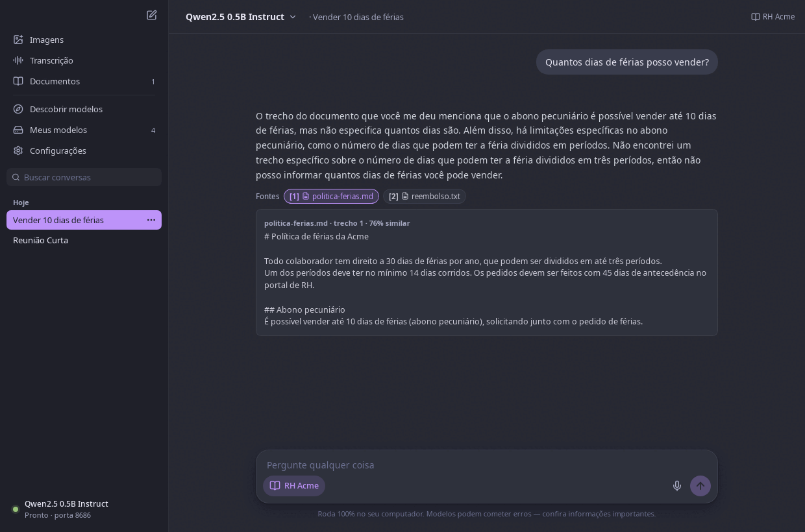
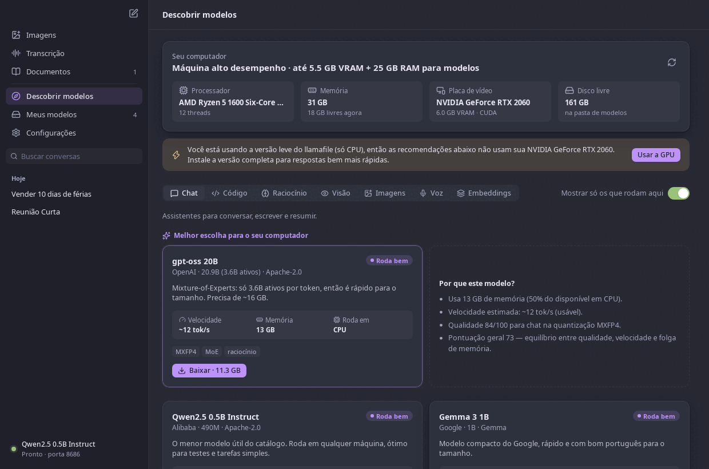
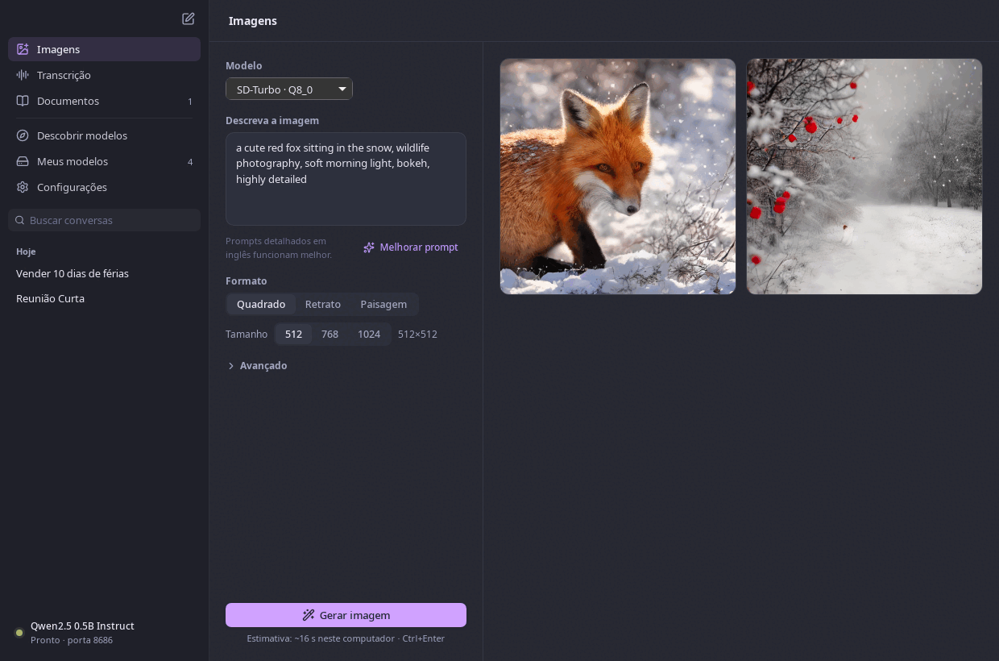
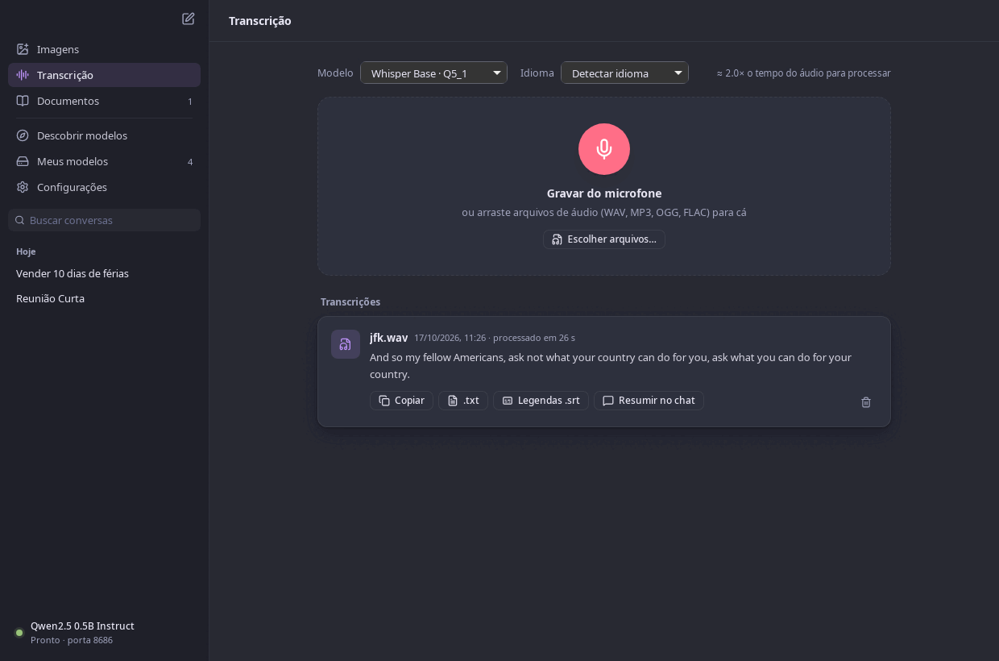
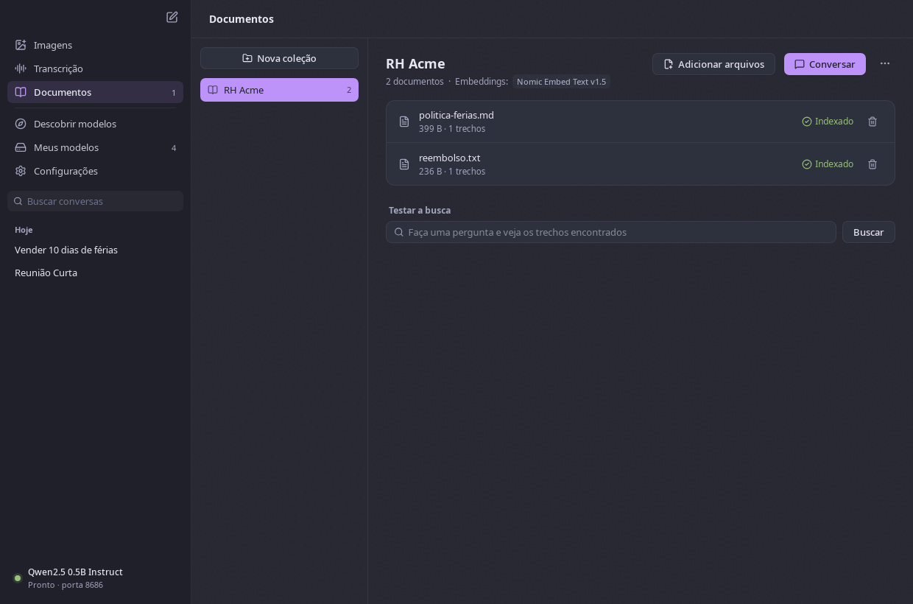
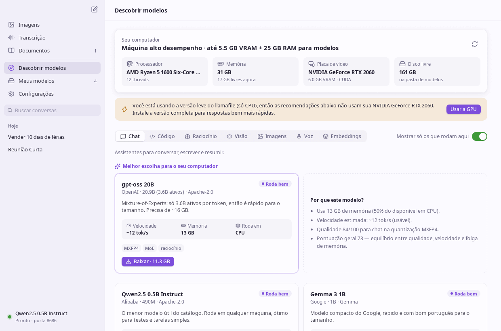

<p align="center">
  
</p>

<h1 align="center">Llamafile UI</h1>

<p align="center">
  Chat, imagens, voz e documentos com IA — rodando 100% no seu computador.<br/>
  Uma interface desktop para o <a href="https://github.com/mozilla-ai/llamafile">llamafile</a> da Mozilla AI,
  que mostra quais modelos rodam melhor na <b>sua</b> máquina.
</p>

<p align="center">
  <a href="https://github.com/devalexandre/llamafile-ui/releases/latest"></a>
  
  
</p>

<p align="center">
  
</p>

## Idiomas

A interface está em **12 idiomas** — English, 中文, हिन्दी, Español, العربية (da direita para a
esquerda), Français, বাংলা, Português, Русский, Bahasa Indonesia, 日本語 e Deutsch. Na primeira
abertura o app usa o idioma do sistema; dá para trocar em *Configurações → Aparência*. Mensagens do
servidor, menu da bandeja, descrições dos modelos e agentes prontos também são traduzidos, e há vozes
do Piper para 10 desses idiomas (bengali e japonês ainda não têm voz compatível).

## Por que usar

- **Privado de verdade:** conversas, documentos, áudios e imagens nunca saem do seu computador.
- **Sem configuração:** o app baixa o llamafile e os modelos para você e escolhe o que cabe no seu hardware.
- **Tudo em um lugar:** chat, geração e edição de imagens, transcrição de voz, leitura em voz alta e perguntas sobre seus documentos.
- **Feito para modelos pequenos e rápidos:** um catálogo curado de modelos que rodam bem em notebooks e desktops comuns.

## Recursos

### 💬 Chat
Respostas em streaming com markdown e código destacado, raciocínio ("thinking") recolhível,
imagens em modelos de visão (anexar ou colar), parar, regenerar, editar e reenviar, e métricas
de tokens/s. O histórico fica salvo e é **agrupado por data** (Hoje, Ontem, 7 dias…), com fixar,
renomear, buscar no conteúdo, exportar para Markdown/JSON e **títulos gerados automaticamente**.

O botão **+** da caixa de mensagem junta tudo no chat, sem tirar as páginas dedicadas:
- **Arquivos:** anexe PDF, Word, texto ou código (o conteúdo vai junto da pergunta), imagens
  (para modelos de visão) ou áudio, que é transcrito para o texto da mensagem. Também dá para arrastar.
- **Gerar imagem:** escreva "crie uma imagem de…" (ou use *+ → Gerar imagem*) e a imagem aparece na
  conversa. Com uma imagem anexada, "transforme…", "deixe o céu roxo…" a usam como referência.
- **Ouvir:** o ícone de alto-falante lê a resposta em voz alta; a leitura automática é opcional.

### 🧭 Descobrir modelos — o que roda bem na sua máquina
O app detecta CPU, RAM, GPU/VRAM (NVIDIA, AMD e Apple Silicon) e, para cada modelo, calcula a
memória necessária, onde ele roda (GPU, GPU+CPU ou CPU), a velocidade estimada e uma nota por
categoria. Em cada categoria ele destaca a **melhor escolha para o seu computador** e explica o porquê.

<p align="center"></p>

### 🎨 Imagens
Geração local com SD-Turbo, SDXL-Turbo, Stable Diffusion 1.5, Z-Image Turbo e FLUX.1 schnell.
Formatos e tamanhos, passos/CFG/seed, **decodificação rápida (TAESD)**, progresso com tempo
estimado e uma galeria para reutilizar, salvar, excluir ou "perguntar no chat". O botão **Melhorar prompt**
usa o modelo de chat local para traduzir e detalhar sua descrição em inglês. Uma **imagem de
referência** (escolhida, arrastada ou uma da galeria) é alterada seguindo a descrição, com
intensidade ajustável e mantendo a proporção (img2img).

**Imagens na GPU:** o `diffusionfile` do llamafile 0.10.x roda só na CPU. Em *Configurações →
Ferramentas* você pode baixar o **stable-diffusion.cpp** (o projeto original do diffusionfile) com
GPU — Vulkan no Linux e no Windows (NVIDIA, AMD e Intel), Metal no Mac com Apple Silicon. Ele usa
os mesmos modelos; no modo *Automático* o app passa a usá-lo assim que é instalado. Numa RTX 2060
o SD-Turbo cai de ~20 s para ~2 s por imagem.

### 🎬 Vídeos
Na mesma página (chave **Imagem / Vídeo**) ou no chat ("crie um vídeo de…", *+ → Gerar vídeo*):
- **Wan 2.1 1.3B** — texto → vídeo, leve.
- **Wan 2.2 5B Turbo** — texto → vídeo ou **anima uma imagem de referência** (primeiro quadro), em 4 passos.

Duração de 1 a 5 s (os modelos foram treinados com clipes de até ~5 s), proporção e resolução
(480 a 832), passos e formato do arquivo (WebM, WebP animado ou AVI). Vídeo exige bem mais
memória: use o stable-diffusion.cpp com GPU. Numa RTX 2060, 2 s em 480p levam de 2 a 3 minutos.

<p align="center"></p>

### 🎙️ Voz
**Ditado no chat** com o botão de microfone e uma página de **Transcrição**: grave ou arraste
arquivos WAV, MP3, OGG ou FLAC, escolha o idioma, copie, exporte `.txt` ou legendas `.srt`, ou
resuma no chat. Usa os modelos Whisper; o áudio gravado é apagado depois da transcrição.

<p align="center"></p>

**Transcrição na GPU e vídeos:** o `whisperfile` do llamafile roda só na CPU. Em *Configurações →
Ferramentas* dá para baixar o **whisper.cpp com GPU** (Vulkan no Linux e no Windows, Metal no Mac),
compilado pelo CI deste projeto e anexado às releases. Numa RTX 2060, 69 s de fala levam 3 s com o
Large v3 Turbo, contra ~100 s do Base na CPU. A decodificação padrão é a gulosa (bem mais rápida); a
busca em feixe fica na opção *Precisão máxima*. Com o `ffmpeg` instalado, também é possível
transcrever **vídeos** (MP4, MKV, MOV, WebM…). As recomendações de voz levam a GPU em conta e
evitam modelos mais lentos que o tempo real.

### 🔊 Leitura em voz alta
As respostas do chat podem ser ouvidas com vozes neurais do [Piper](https://github.com/rhasspy/piper)
(Faber, Cadu e Jeff em português, além de inglês e espanhol). O Piper é instalado em
*Configurações → Ferramentas*, as vozes em *Descobrir → Leitura em voz alta*, e roda na CPU bem
mais rápido que o tempo real: a fala começa enquanto o resto ainda está sendo gerado. Código,
links e tabelas são simplificados antes da leitura. Velocidade e leitura automática ficam em
*Configurações*.

### 📚 Documentos (RAG)
Crie coleções com PDF, Word (.docx), Markdown, texto, HTML ou código. Os arquivos são indexados
localmente com um modelo de embeddings (Qwen3 Embedding, BGE-M3 ou Nomic). No chat, escolha uma
coleção: a resposta usa os trechos mais relevantes e mostra as **fontes citadas** ([1], [2]…),
que você pode abrir para conferir.

<p align="center"></p>

### ⚙️ Configurações e mais
- **Ícone na bandeja do sistema:** fechar a janela mantém o app e o servidor rodando em segundo
  plano (a API continua disponível). Pelo menu da bandeja você abre a janela, inicia uma nova
  conversa, vê o modelo carregado, para o servidor ou sai. Dá para desligar em Configurações.
- Porta e endereço do servidor, aceleração (GPU), tamanho do contexto, threads e iniciar com o app.
- Instruções do sistema, temperatura e títulos automáticos.
- Tema **Nocturne**, próprio do app (inspirado no Dracula e no One Dark), nos modos claro e escuro.
- O servidor expõe uma **API compatível com OpenAI** em `http://127.0.0.1:8686/v1`, que outras
  ferramentas podem usar enquanto o app está aberto.

<p align="center"></p>

## Instalação

Baixe o arquivo do seu sistema na página de [Releases](https://github.com/devalexandre/llamafile-ui/releases/latest)
e siga os passos abaixo.

| Sistema | Arquivo |
|---|---|
| **Windows 10/11** (x64) | `llamafile-ui-<versão>-windows-amd64-setup.exe` (instalador, recomendado) ou `llamafile-ui-<versão>-windows-amd64.exe` (portátil) |
| **macOS 12+** (Intel e Apple Silicon) | `llamafile-ui-<versão>-macos-universal.zip` |
| **Ubuntu 24.04+, Debian 13+, Mint 22+** | `llamafile-ui_<versão>_amd64.deb` |
| **Fedora 40+, openSUSE** | `llamafile-ui-<versão>-1.x86_64.rpm` |
| **Arch, Manjaro, EndeavourOS** | `llamafile-ui-<versão>-1-x86_64.pkg.tar.zst` |
| **Outras distribuições** | `llamafile-ui-<versão>-x86_64.AppImage` (quando disponível) ou `llamafile-ui-<versão>-linux-amd64.tar.gz` |

> Os binários ainda não são assinados digitalmente. Por isso o Windows e o macOS mostram um aviso
> na primeira vez; os passos abaixo explicam como liberar. Você pode conferir a integridade do
> download com o `SHA256SUMS.txt` da release.

### Windows

**Com o instalador (recomendado)**

1. Dê dois cliques em `llamafile-ui-<versão>-windows-amd64-setup.exe`.
2. Se aparecer **"O Windows protegeu o computador"** (SmartScreen), clique em **Mais informações → Executar assim mesmo**.
3. Aceite o pedido de permissão de administrador e conclua o assistente.
   - O app é instalado em `C:\Program Files\devalexandre\Llamafile UI`.
   - Se faltar o **Microsoft Edge WebView2** (já vem no Windows 11), o instalador o baixa automaticamente.
   - São criados atalhos no **Menu Iniciar** e na **Área de Trabalho**.
4. Abra **Llamafile UI** pelo Menu Iniciar.

Para desinstalar: **Configurações → Aplicativos → Aplicativos instalados → Llamafile UI → Desinstalar**.
Seus modelos e conversas ficam em `%LOCALAPPDATA%\LlamafileUI`; apague essa pasta se quiser remover tudo.

**Versão portátil (sem instalar)**

1. Coloque `llamafile-ui-<versão>-windows-amd64.exe` em uma pasta de sua preferência (por exemplo, `Documentos\Llamafile`).
2. Dê dois cliques nele. No aviso do SmartScreen, use **Mais informações → Executar assim mesmo**.
3. A versão portátil precisa do WebView2. Se o app não abrir no Windows 10, instale o
   [WebView2 Runtime](https://developer.microsoft.com/microsoft-edge/webview2/) (opção *Evergreen Bootstrapper*).

Na primeira vez em que o app iniciar o llamafile, o **Firewall do Windows** pode perguntar sobre
acesso à rede. Você pode recusar: o servidor só escuta em `127.0.0.1`, a menos que você mude o
endereço nas Configurações.

### macOS

1. Dê dois cliques em `llamafile-ui-<versão>-macos-universal.zip` para descompactar. Vai aparecer o **Llamafile UI.app**.
2. Arraste o **Llamafile UI.app** para a pasta **Aplicativos**.
3. Abra o app pela pasta Aplicativos. Como ele não é notarizado pela Apple, o macOS vai bloquear a primeira abertura:
   - **macOS 15 (Sequoia) ou mais novo:** feche o aviso, abra **Ajustes do Sistema → Privacidade e Segurança**,
     role até a mensagem sobre o *Llamafile* e clique em **Abrir Mesmo Assim**. Confirme com sua senha.
   - **macOS 14 ou anterior:** clique com o **botão direito** (ou Control + clique) no app → **Abrir** → **Abrir**.
4. Nas próximas vezes ele abre normalmente, inclusive pelo Launchpad e pelo Spotlight.

Se preferir o Terminal, este comando remove a quarentena de uma vez:

```bash
xattr -dr com.apple.quarantine "/Applications/Llamafile UI.app"
```

Ao usar o ditado ou a gravação pela primeira vez, o macOS pede permissão para o **microfone**;
clique em **Permitir**. Para desinstalar, mova o app para o Lixo e, se quiser apagar modelos e
conversas, remova `~/Library/Application Support/LlamafileUI`.

### Linux

O app usa **GTK 4** e **WebKitGTK 6**. Os pacotes `.deb`, `.rpm` e do Arch instalam essas
dependências automaticamente, além do atalho no menu de aplicativos e do ícone.

**Ubuntu, Debian, Mint (`.deb`)**

```bash
sudo apt install ./llamafile-ui_*_amd64.deb
```

**Fedora, openSUSE (`.rpm`)**

```bash
sudo dnf install ./llamafile-ui-*.x86_64.rpm        # Fedora
sudo zypper install ./llamafile-ui-*.x86_64.rpm     # openSUSE
```

**Arch, Manjaro, EndeavourOS**

```bash
sudo pacman -U llamafile-ui-*-x86_64.pkg.tar.zst
```

Depois abra **Llamafile UI** pelo menu de aplicativos (ou rode `llamafile-ui` no terminal).
Para desinstalar: `sudo apt remove llamafile-ui`, `sudo dnf remove llamafile-ui` ou
`sudo pacman -R llamafile-ui`. Modelos e conversas ficam em `~/.local/share/LlamafileUI`.

**Outras distribuições**

- **AppImage** (quando presente na release): `chmod +x llamafile-ui-*.AppImage && ./llamafile-ui-*.AppImage`.
- **`.tar.gz`**: instale `gtk4` e `webkitgtk-6.0` pelo gerenciador de pacotes da sua distribuição e rode:

  ```bash
  tar xzf llamafile-ui-*-linux-amd64.tar.gz
  ./llamafile-ui
  ```

O microfone é acessado pelo PulseAudio/PipeWire do sistema, sem configuração extra. No **GNOME**,
o ícone da bandeja só aparece com a extensão
[AppIndicator](https://extensions.gnome.org/extension/615/appindicator-support/) (já vem no Ubuntu).

## Primeiros passos

1. **Instale o llamafile.** Na primeira abertura, o app vai direto para Configurações e oferece:
   - **Versão completa** (~350 MB): usa a GPU, recomendada se você tem placa de vídeo.
   - **Versão leve** (~42 MB): só CPU.
   - **Já tenho o arquivo…**: aponta para um llamafile que você já tem.
2. **Escolha um modelo** em *Descobrir modelos*. Comece pela "Melhor escolha para o seu computador".
3. **Converse.** O modelo carrega sozinho na primeira mensagem.
4. Para **imagens** e **voz**, as páginas oferecem baixar o `diffusionfile` / `whisperfile` (os
   executáveis da mesma release oficial) e um modelo recomendado.
5. Para **documentos**, baixe um modelo de embeddings (são pequenos), crie uma coleção, arraste os
   arquivos e clique em **Conversar**.

## Modelos do catálogo

| Categoria | Modelos |
|---|---|
| Chat | Qwen3 (1.7B, 4B, 8B), Gemma 3 (1B, 4B), Llama 3.2 (1B, 3B), Phi-4 mini, Granite 3.3 2B, SmolLM2, Mistral 7B, gpt-oss 20B |
| Código | Qwen2.5 Coder (1.5B, 3B, 7B), Qwen3 |
| Raciocínio | DeepSeek R1 Distill (1.5B, 7B), Qwen3, Phi-4 mini, gpt-oss 20B |
| Visão | Gemma 3 4B, Qwen2.5 VL 3B, SmolVLM2 2.2B |
| Imagens | SD-Turbo, SDXL-Turbo, Stable Diffusion 1.5, Z-Image Turbo, FLUX.1 schnell |
| Vídeos | Wan 2.1 1.3B (texto → vídeo), Wan 2.2 5B Turbo (texto ou imagem → vídeo) |
| Voz | Whisper Tiny, Base, Small, Medium e Large v3 Turbo |
| Embeddings | Qwen3 Embedding 0.6B, BGE-M3, Nomic Embed v1.5 |
| Leitura em voz alta | Piper: Faber, Cadu e Jeff (pt-BR), Amy e Lessac (en-US), Davefx (es-ES) |

Arquivos `.gguf` colocados manualmente na pasta de modelos também aparecem em *Meus modelos* e
podem ser usados no chat.

## Como a recomendação funciona

O método é inspirado no [llmfit](https://github.com/AlexsJones/llmfit), mas adaptado para
GGUF/llamafile e sem dependências externas (`internal/catalog/fit.go`):

| Etapa | Como é calculado |
|---|---|
| Memória necessária | pesos × 1,05 + projetor de visão + componentes + KV cache (pelo contexto) + overhead |
| Onde roda | GPU se cabe na VRAM; GPU+CPU se cabe em VRAM+RAM; senão CPU (Apple: memória unificada) |
| Encaixe | uso ≤ 60% roda perfeitamente · ≤ 85% roda bem · ≤ 98% no limite · acima disso não cabe |
| Velocidade (texto) | largura de banda da memória ÷ bytes lidos por token × eficiência (MoE conta só os parâmetros ativos) |
| Velocidade (imagem/voz) | segundos por imagem e fator de tempo real, calibrados em execuções reais; GPU só quando o build da ferramenta tem backend de GPU (detectado pelos logs) |
| Calibração | cada resposta, imagem e transcrição mede a velocidade real; o modelo medido mostra "medido" e os demais do mesmo tipo são ajustados pela mediana ("calibrado") |
| Nota final | média ponderada de qualidade, velocidade, encaixe e contexto, com pesos por categoria |

Se o llamafile instalado for a versão leve, as recomendações assumem CPU e o app sugere a versão
completa para aproveitar a GPU.

O botão **Medir** em *Meus modelos* roda um benchmark curto (160 tokens) e as medições ficam em
*Configurações → Medições de velocidade*, por hardware: trocar de GPU ou de RAM descarta as antigas.
Em *Configurações → Ferramentas*, o app mostra se o `whisperfile` e o `diffusionfile` instalados usam
GPU ou só CPU, e avisa quando há uma versão nova.

## Privacidade

O app só acessa a internet quando você pede: para baixar executáveis (GitHub da Mozilla AI) e
modelos (Hugging Face). Os dados ficam em:

- **Linux:** `~/.local/share/LlamafileUI`
- **macOS:** `~/Library/Application Support/LlamafileUI`
- **Windows:** `%LOCALAPPDATA%\LlamafileUI`

Nessa pasta estão os modelos, as conversas e os documentos indexados (`chats.db`, SQLite), as
imagens geradas e os executáveis. Configurações → *Dados do aplicativo* abre essa pasta.

## Solução de problemas

| Problema | O que fazer |
|---|---|
| **"A porta 8686 já está em uso"** | Mude a porta em Configurações → Rede e clique em *Reiniciar para aplicar*. |
| **Respostas lentas** | Veja se está usando a versão leve do llamafile (aviso em Descobrir) ou escolha um modelo menor. |
| **Imagens não ficam como descrito** | Use prompts em inglês ou o botão **Melhorar prompt**. |
| **Imagem/voz lentas** | Nesta release, `diffusionfile` e `whisperfile` rodam na CPU (Metal no Mac). Prefira SD-Turbo e Whisper Base/Small. |
| **Janela em branco no Linux com NVIDIA** | O app já define `WEBKIT_DISABLE_DMABUF_RENDERER=1`. Se persistir, rode `WEBKIT_DISABLE_COMPOSITING_MODE=1 ./llamafile-ui`. |
| **llamafile não inicia no Linux** | O app executa o llamafile via `sh`, para não esbarrar no `binfmt_misc` (ex.: Wine). Veja o log em Configurações → Diagnóstico. |
| **Microfone não funciona** | Confira a permissão de microfone do sistema (macOS: Ajustes → Privacidade → Microfone). |
| **Fechei a janela e o app continua rodando** | É o modo bandeja: use **Sair** no menu do ícone da bandeja, ou desligue *Manter na bandeja ao fechar* em Configurações. |
| **O ícone da bandeja não aparece (GNOME)** | Instale a extensão [AppIndicator](https://extensions.gnome.org/extension/615/appindicator-support/). Abrir o app de novo pelo menu traz a janela de volta. |

## Desenvolvimento

Requisitos: Go 1.25+, Node 20+, [Wails CLI v3](https://v3.wails.io/getting-started/installation/)
e, no Linux, os pacotes de desenvolvimento de **GTK 4** e **WebKitGTK 6** (`libgtk-4-dev` e
`libwebkitgtk-6.0-dev` no Ubuntu/Debian; `gtk4` e `webkitgtk-6.0` no Arch). A gravação de áudio usa
[miniaudio](https://github.com/gen2brain/malgo) via cgo, então é preciso um compilador C (gcc ou clang).

```bash
go install github.com/wailsapp/wails/v3/cmd/wails3@v3.0.0-beta.30

wails3 dev                        # modo desenvolvimento com hot reload
wails3 build                      # binário de produção em bin/llamafile-ui
wails3 package                    # pacotes do sistema atual (instalador, .app, .deb/.rpm/AppImage)

wails3 task linux:create:deb      # só o .deb (também: create:rpm, create:aur, create:appimage)
```

> O projeto usa o **Wails v3** (beta). As configurações de build e empacotamento ficam em
> `build/config.yml` e nos `Taskfile.yml`. Depois de mudar `info` no `config.yml`, rode
> `wails3 task common:update:build-assets` e re-adicione `NSMicrophoneUsageDescription` aos
> `build/darwin/Info*.plist` (o comando sobrescreve esses arquivos).

**Eventos do backend.** Os eventos do Go para o React (streaming do chat, progresso de downloads,
imagens, transcrições) trafegam por *long-polling* HTTP (`GET /_bus/events`, em
`internal/eventbus`), e não pelos eventos por injeção de script do Wails. Com WebKitGTK 6, os
scripts injetados deixavam de executar assim que o app iniciava um processo filho (o servidor
llamafile), enquanto as requisições HTTP continuavam funcionando.

### Testes

```bash
go test ./...

# Integração com os executáveis reais (precisam estar instalados pelo app):
go test -tags integration ./internal/chat ./internal/rag ./internal/imagegen -v
VOICE_SAMPLE=fala.wav go test -tags integration ./internal/voice -v
```

### Traduções

Os textos são escritos em português e usados como chave: `t("Salvar")` no frontend e
`i18n.T("Salvar")` no Go. As traduções ficam em `internal/i18n/locales/<idioma>.json` (as mesmas para
a interface e o backend). `go run ./tools/i18n` mostra o que falta em cada idioma e o teste
`TestLocalesComplete` falha se algum texto ficar sem tradução ou com marcadores (`%s`, `{nome}`) diferentes.

### Atualizar o catálogo de modelos

Edite `tools/catalog/models.json` (metadados, notas de qualidade e componentes) e rode:

```bash
go run ./tools/catalog
```

O gerador consulta a API do Hugging Face para preencher URLs e tamanhos reais e grava
`internal/catalog/catalog.json`, que é embutido no binário. Componentes compartilhados (como o
VAE do FLUX) são baixados uma única vez.

### Estrutura

```
main.go                    janela, bandeja do sistema, instância única e servidor de assets
app*.go                    serviço Wails: métodos expostos ao frontend (um arquivo por área)
internal/
  eventbus/                eventos Go → frontend por long-polling HTTP
  catalog/                 catálogo embutido + fit engine (recomendação)
  hardware/                detecção de CPU/RAM/GPU por sistema operacional
  tools/                   llamafile, whisperfile, diffusionfile e stable-diffusion.cpp: release, download, execução
  archive/                 extração segura de .zip e .tar.gz
  runtime/                 servidores llamafile (chat e embeddings): iniciar, health-check, parar
  downloads/               downloads retomáveis
  chat/                    SQLite das conversas + streaming da API OpenAI + RAG no prompt
  rag/                     extração de texto, chunks, embeddings e busca por similaridade
  imagegen/                geração com diffusionfile, progresso e galeria
  voice/                   gravação do microfone (miniaudio) e transcrição com whisperfile
  tts/                     Piper: instalação, limpeza do markdown e reprodução em streaming
  bench/                   medições de velocidade e capacidades (GPU) das ferramentas
  settings/, paths/        preferências e diretórios do app
frontend/src/
  pages/                   Chat, Imagens, Transcrição, Documentos, Descobrir, Meus modelos, Configurações
  components/              Sidebar, cartões de modelo, controles no estilo macOS
build/                     config.yml, Taskfiles, ícones, Info.plist, NSIS e nfpm (pacotes Linux)
tools/catalog/             gerador do catálogo
```

### Releases

A cada push ou merge em `main`/`master` (exceto mudanças só em documentação), o workflow
[`release.yml`](.github/workflows/release.yml) roda os testes, gera o instalador NSIS e o `.exe`
portátil do Windows, o `.app` universal do macOS, os pacotes `.deb`, `.rpm` e do Arch, o
`.tar.gz` (e, quando possível, o AppImage) do Linux, e publica uma release `v0.2.<número da execução>`
com checksums SHA-256.

## Próximos passos

- Escolher a voz automaticamente pelo idioma da resposta.

## Créditos

Construído sobre projetos incríveis: [llamafile](https://github.com/mozilla-ai/llamafile)
(Mozilla AI), [llama.cpp](https://github.com/ggml-org/llama.cpp),
[whisper.cpp](https://github.com/ggml-org/whisper.cpp),
[stable-diffusion.cpp](https://github.com/leejet/stable-diffusion.cpp) (leejet), [Piper](https://github.com/rhasspy/piper), [Wails](https://wails.io)
e [miniaudio](https://miniaud.io). Recomendações inspiradas no [llmfit](https://github.com/AlexsJones/llmfit);
tema inspirado no [Dracula](https://draculatheme.com) e no [One Dark](https://github.com/atom/atom/tree/master/packages/one-dark-ui).
Os modelos pertencem aos seus autores e seguem as respectivas licenças.
